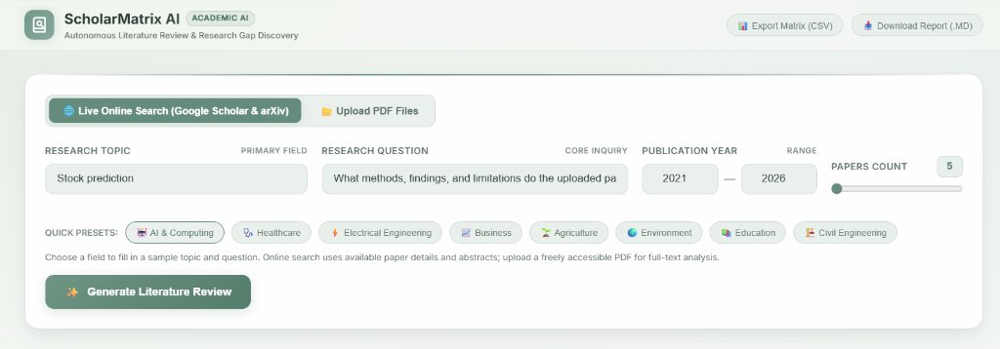

# ScholarMatrix AI

ScholarMatrix AI is an autonomous academic literature review and research synthesis engine. Ingest literature via live Google Scholar search (powered by Serper API) and arXiv, or upload your own research-paper PDFs. ScholarMatrix AI extracts full-text methodology and findings, compares papers in a structured literature matrix, uncovers evidence-backed research gaps, and compiles a comprehensive thematic systematic literature review report.

---

## Interface

### 1. Research Control Panel & Discovery


### 2. Extracted Research Papers & Findings


---

## Key Features

- **Multi-Source Scholarly Retrieval:** Live Google Scholar indexing via Serper API, supplemented with arXiv, or direct local PDF manuscript uploads.
- **Full-Text PDF Extraction:** Automatically resolves and downloads open-access manuscripts, parsing full-text content across all pages (methods, datasets, metrics, limitations) rather than relying solely on abstracts.
- **Comparative Literature-Review Matrix:** Analyzes and tabulates research focus, proposed methodology, benchmark datasets, empirical metrics, key results, and identified limitations side by side across 6 standardized columns.
- **Evidence-Grounded Research Gaps:** Extracts verbatim limitation and future-work quotes directly from each paper's text with explicit citation attribution.
- **Thematic Systematic Review Report:** Performs true cross-study meta-synthesis:
  1. *Executive Synthesis & State of the Art* (citation impact, landmark studies, field consensus)
  2. *Methodological Taxonomy & Thematic Paradigms* (groups papers into architectural, benchmarking, and applied archetypes)
  3. *Empirical Evaluation & Benchmark Landscape* (common benchmark corpora, standard metrics, and quantitative trends)
  4. *Cross-Study Limitation Meta-Analysis* (generalizability, computational overhead, and boundary sensitivity)
  5. *Synthesis on the Core Research Question* (substantiated progress and remaining open challenges)
  6. *Strategic Research Agenda & 4-Point Roadmap* (concrete directions for future research)
  7. *Systematic Corpus Bibliography* (formal academic references with manuscript links)
- **Zero Hallucination Guarantee:** Uses deterministic rule-based linguistic extraction and verified gazetteers—unreported items are labeled as not reported rather than synthetically hallucinated.
- **Direct Exports:** Download the comparative matrix as CSV, copy as Markdown table, or download the full synthesis report as Markdown (`.md`).

---

## Technology Stack

| Area | Technologies |
|---|---|
| **Backend Language** | Python 3.10+ |
| **Web API & Framework** | FastAPI, Uvicorn |
| **Scholarly Search Engines** | Google Scholar via Serper API (`https://google.serper.dev/scholar`), arXiv API |
| **HTTP & PDF Ingestion** | Python standard-library `urllib`, `concurrent.futures.ThreadPoolExecutor` |
| **PDF Text Parsing** | `pypdf` (multi-page selectable text extraction) |
| **Upload Processing** | FastAPI multipart streaming via `python-multipart` |
| **Frontend Framework** | Pure Vanilla JavaScript (ES6+), HTML5, CSS3 (No Node.js build step needed) |
| **Markdown Rendering** | Marked.js |
| **Typography** | Inter from Google Fonts |

Python dependencies are listed in [`requirements.txt`](requirements.txt).

---

## Local Development Setup

### 1. Clone & Set Up Virtual Environment

In Windows PowerShell:
```powershell
git clone <your-repository-url>
cd FSI_Main_project

python -m venv .venv
.\.venv\Scripts\Activate.ps1
pip install -r requirements.txt
```

In Linux / macOS:
```bash
git clone <your-repository-url>
cd FSI_Main_project

python3 -m venv .venv
source .venv/bin/activate
pip install -r requirements.txt
```

### 2. Configure Serper API Key

Create a `.env` file in the project root:
```env
SERPER_API_KEY=your_serper_api_key_here
```
*(The `.env` file is git-ignored by `.gitignore` to prevent exposing your secret key).*

### 3. Start the Application

```powershell
python run.py
```
This automatically starts the local FastAPI server and launches your default browser at **[http://127.0.0.1:8000](http://127.0.0.1:8000)**.

Alternatively, launch Uvicorn directly:
```powershell
python -m uvicorn backend.app:app --host 127.0.0.1 --port 8000 --reload
```

---

## Running Unit Tests

Run the comprehensive test suite (15 tests covering parsing, Serper integration, deduplication, and report generation):
```powershell
python -m unittest discover tests
```

---

## Deployment on Render (Cloud Web Service)

To deploy ScholarMatrix AI as a live public web service on [Render.com](https://render.com):

### Step 1: Create a New Web Service on Render
1. Log into your Render dashboard and click **New +** ➔ **Web Service**.
2. Connect your GitHub repository.

### Step 2: Configure Service Settings
| Setting | Recommended Value |
|---|---|
| **Name** | `scholarmatrix-ai` (or your choice) |
| **Region** | Oregon (US West) or closest to you |
| **Branch** | `main` |
| **Root Directory** | *(Leave empty)* |
| **Runtime** | `Python 3` |
| **Build Command** | `pip install -r requirements.txt` |
| **Start Command** | `uvicorn backend.app:app --host 0.0.0.0 --port $PORT` |
| **Instance Type** | Free |

### Step 3: Add Environment Variables
Under the **Environment Variables** tab in Render, add:
* `SERPER_API_KEY`: `your_serper_api_key`
* `PYTHONUNBUFFERED`: `1`

### Why PDF Uploads Work Seamlessly on Render:
* **Persistent Uploads Directory Tracking:** The repository includes [`uploads/.gitkeep`](uploads/.gitkeep) so Git tracks the `uploads` directory structure.
* **Auto-Creation Safeguard:** `backend/app.py` automatically checks and recreates `UPLOAD_DIR` on any request before writing, preventing `FileNotFoundError` on ephemeral cloud instances.
* **Host Binding:** `uvicorn --host 0.0.0.0 --port $PORT` binds to Render's public network interface and assigns the dynamic cloud port.

---

## API Endpoints

| Method | Endpoint | Purpose |
|---|---|---|
| `GET` | `/api/health` | Check service health and readiness |
| `GET` | `/api/uploaded-pdfs` | List and parse PDF documents stored in uploads |
| `DELETE` | `/api/uploaded-pdfs` | Delete all stored uploaded PDF files |
| `POST` | `/api/upload-pdfs` | Upload and extract selectable text from PDF files |
| `POST` | `/api/generate-full-review` | End-to-end literature review generation (online or PDF mode) |
| `GET` | `/api/export/csv` | Download comparative literature matrix as CSV |
| `GET` | `/api/export/markdown` | Download the full systematic review report as Markdown |

---

## Project Structure

```text
FSI_Main_project/
├── assets/
│   ├── interface.png               # Control panel screenshot
│   ├── interface_control_panel.jpg # Control panel & discovery screenshot
│   └── interface_papers_list.jpg   # Paper cards & findings screenshot
├── backend/
│   ├── app.py                      # FastAPI routes & orchestration
│   ├── config.py                   # Paths, unverified SSL context & Serper API key loader
│   └── services/
│       ├── export_service.py       # CSV and BibTeX export generator
│       ├── gap_analyzer.py         # Evidence-based research gap extractor
│       ├── matrix_generator.py     # 6-column literature matrix generator
│       ├── paper_fetcher.py        # Serper Google Scholar & arXiv discovery + PDF downloader
│       ├── pdf_parser.py           # Multi-page selectable text PDF extractor
│       └── report_generator.py     # Thematic systematic review report engine
├── frontend/
│   ├── index.html                  # Main interactive workspace
│   ├── css/
│   │   └── style.css               # Academic calm design system
│   └── js/
│       ├── app.js                  # Application controller & state orchestrator
│       ├── gaps.js                 # Research gaps workspace renderer
│       ├── matrix.js               # Comparative matrix workspace renderer
│       └── report.js               # Rendered review report & dynamic TOC renderer
├── tests/
│   └── test_paper_analysis.py      # Unit tests (15 test cases)
├── uploads/                        # Local PDF manuscript storage
│   └── .gitkeep                    # Directory preservation for Git deployment
├── .gitignore                      # Git ignore rules (ignores .env, cache, uploaded PDFs)
├── requirements.txt                # Python dependencies
├── run.py                          # Cross-platform runner (local desktop & cloud host)
└── README.md                       # Documentation
```

---

## License

This project is licensed under the MIT License.
